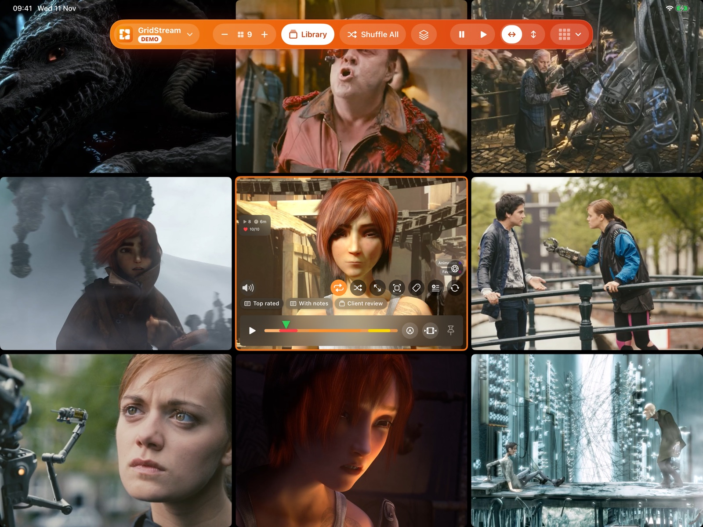

# GridStream

GridStream plays up to twelve videos at once on an iPad, streamed from a library on your Mac over your local network. Tap a tile and the sound follows it, scrub frame by frame, draw on a frame with the Apple Pencil, rate, tag and sort the library. It is local-only: no cloud, no account, no data collected.



> **Experimental.** GridStream is a personal project and a playground for video interactions, shared as is. Expect rough edges. Security has been hardened but not audited; read [SECURITY.md](SECURITY.md) before running it on a network you don't fully trust.

The iPad app and a signed build of the Mac server are available at [andrefrelicot.dev/gridstream](https://andrefrelicot.dev/gridstream/).

## What's inside

| Folder | What it is |
| --- | --- |
| `gridstream-macos/` | Menu bar app for macOS (SwiftUI). It indexes your video folders into SQLite (GRDB), serves a REST API and the video streams over HTTP (Vapor), hosts the web UI and announces itself with Bonjour. |
| `gridstream-ipad/` | iPad client (SwiftUI, AVFoundation, PencilKit). It shows a grid of up to twelve videos, precision scrubbing, full screen with floating windows, solo/mute and layouts, plus tags, ratings, smart lists, annotations, time ranges and frame captures. |
| `gridstream-web/` | Web UI (Angular). It is used to manage the library from a browser, is built into the macOS app and is served by it. |
| `GridStreamKit/` | Swift package shared by the two Swift apps: the API wire types and their JSON rules. `contracts/fixtures/` holds sample payloads both sides are tested against, and `contracts/decisions.md` the rules they follow. |
| `scripts/` | Web build and embedding, the macOS release script (Developer ID, notarization) and the demo pack builder. |

The Mac is the source of truth for the catalog and its metadata; clients only keep layout and UI state.

Supported files: `.mp4`, `.m4v` and `.mov` that AVFoundation can play (H.264, HEVC tagged `hvc1`).

## Requirements

- macOS 15.6 or later to run the server; Xcode 26 to build.
- iPadOS 17 or later.
- Node.js 22.20.0 and npm 11.7.0, to build the web UI (`npm install --global npm@11.7.0`).

## Build

1. Signing configuration (needed once):

   ```bash
   cp gridstream-macos/Config/Local.xcconfig.example gridstream-macos/Config/Local.xcconfig
   ```

   Set your bundle id prefix and Apple team id in it. The file is git-ignored, and the iPad project reads it too.

2. Web UI. The macOS build compiles it and embeds it in the app whenever its sources changed, as long as Node.js is installed. To build it on its own:

   ```bash
   scripts/build-web.sh
   ```

3. macOS app:

   ```bash
   xcodebuild -project gridstream-macos/gridstream-macos.xcodeproj -scheme gridstream-macos -destination 'platform=macOS' -derivedDataPath /tmp/gridstream-macos -IDEBuildLocationStyle=DeriveData build
   ```

4. iPad app: open `gridstream-ipad/gridstream-ipad.xcodeproj` in Xcode and run it on an iPad or the simulator.

## Use

1. Launch GridStream on the Mac and add one or more video folders in its settings. The first scan runs in the background.
2. Note the PIN shown in the menu bar window. Authentication is on by default.
3. Open the iPad app on the same network. It finds the Mac through Bonjour and asks for the PIN.
4. Or open `http://<your-mac>.local:8080` in a browser for the web UI. It is served on the same port as the API; the Web tab of the Mac app's Settings shows the address and turns it off.

## Tests

```bash
xcodebuild -project gridstream-macos/gridstream-macos.xcodeproj -scheme gridstream-macos -destination 'platform=macOS' -derivedDataPath /tmp/gridstream-macos -IDEBuildLocationStyle=DeriveData test
```

```bash
xcodebuild -project gridstream-ipad/gridstream-ipad.xcodeproj -scheme gridstream-ipad -destination 'platform=iOS Simulator,name=<an iPad simulator>' -derivedDataPath /tmp/gridstream-ipad -IDEBuildLocationStyle=DeriveData test
```

```bash
cd gridstream-web && npm ci && npm run lint && npm test
```

```bash
swift test --package-path GridStreamKit
```

`.github/workflows/ci.yml` runs the same four suites on GitHub Actions. It never starts on its own: run it by hand from the Actions tab.

## Web UI development

`npm start` in `gridstream-web` serves the UI with live reload and proxies `/api` to `http://localhost:8080`. Set `GRIDSTREAM_SERVER` to point it at another Mac.

## Security

See [SECURITY.md](SECURITY.md).

## License

MIT. See [LICENSE](LICENSE).

The demo clips the iPad app can download are excerpts of open films by the Blender Foundation: *Tears of Steel* and *Sintel* (CC BY 3.0), *Elephants Dream* (CC BY 2.5). They are not part of this repository.
